# HaoPaste

English | [简体中文](README.md)

Current version: **v0.15.0**

A native, fast, keyboard-first clipboard manager for macOS. Press `⌥⌘V` in any app to open a borderless floating panel, then search, select, and copy without breaking your flow.

> Design goal: the polish of Raycast and Paste, with the native semantics and restraint of Apple's Human Interface Guidelines.

| Light | Dark |
| --- | --- |
| 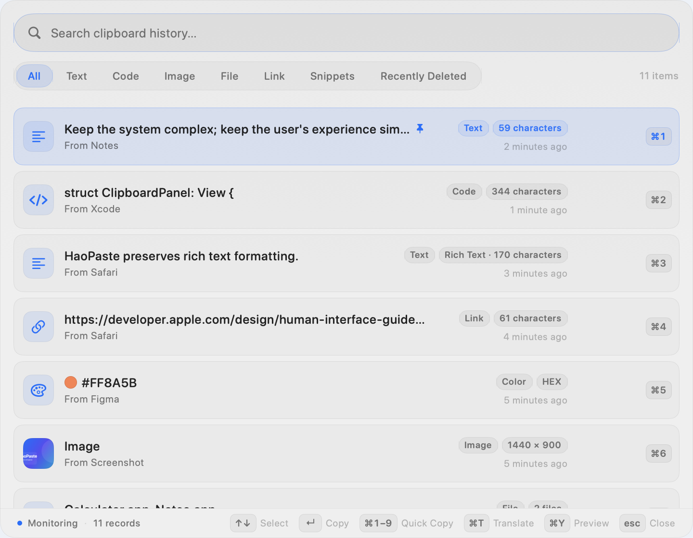 | 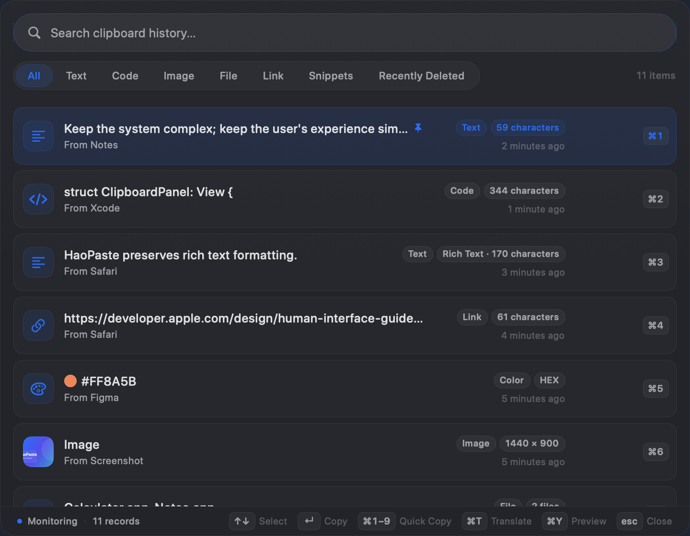 |

*Screenshots use sample data and are generated by the app's built-in off-screen renderer.*

---

## Install

1. Download or build the DMG:

   ```bash
   make dmg
   # dist/HaoPaste-0.15.0.dmg
   # dist/HaoPaste-0.15.0.dmg.sha256
   ```

2. Open `HaoPaste-0.15.0.dmg`, then drag **HaoPaste** into **Applications**.
3. If macOS says the developer cannot be verified:
   - Open **System Settings → Privacy & Security**
   - Under **Security**, find **HaoPaste**
   - Click **Open Anyway**
   - You can also right-click HaoPaste in Finder and choose **Open**
4. Launch HaoPaste from Applications or Spotlight. The panel appears once on first launch.
5. After that, press `⌥⌘V` or click the clipboard icon in the menu bar. Right-click the menu bar icon to pause monitoring, clear history, or quit.

HaoPaste is an `LSUIElement` menu bar app and **does not appear in the Dock**. Look for the clipboard icon in the menu bar.

To install and launch locally:

```bash
make install     # installs to /Applications, falling back to ~/Applications
```

The DMG is signed ad-hoc. If Gatekeeper blocks the first launch, follow the Privacy & Security steps above.

For install, quit, uninstall, and FAQ details, see the [User Guide](Docs/USER_GUIDE.md) (Chinese).

### Clipboard Shelf (top / left / right)

| Light | Dark |
| --- | --- |
| 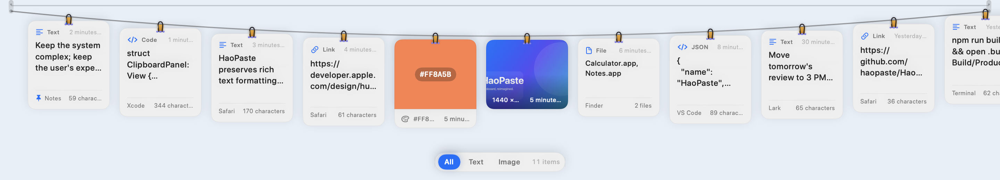 | 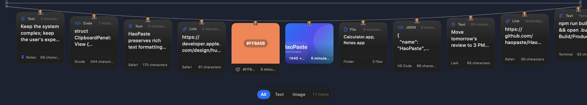 |

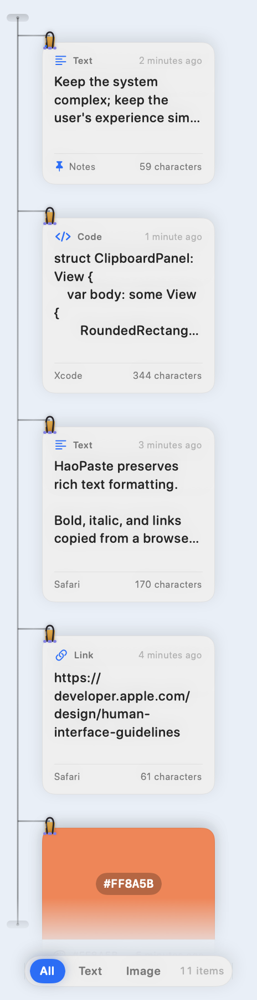

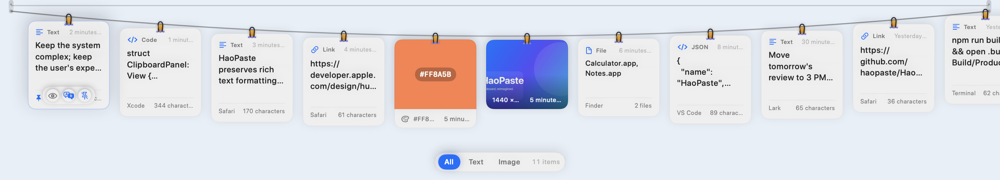

- Enabled by default. Move the pointer to the middle third of the selected screen edge to reveal recent items. The default edge is the top.
- Change the edge in **Settings → General → Position**. Side shelves scroll vertically.
- Card height adapts to image aspect ratio and text length; images keep their real proportions.
- Click a card to copy immediately. The shelf stays open by default, or can hide immediately / after 0.6 seconds in **Settings → General → Copy Behavior**.
- Hover a card to preview, translate / recognize and translate, or pin it. Click the clip to release and delete the card.
- Preview, OCR, and translation open as floating cards over the current app instead of switching to the main panel.
- Context menus support copy, copy as plain text, open link / file, save image, and color format copies.
- Text generated inside HaoPaste (OCR, translation, snippets, Markdown / color formats) enters clipboard history when copied, with content-hash deduplication.
- New copies drop into an open shelf with a spring animation and replace old cards smoothly at the load limit.
- Deleted items move to **Recently Deleted** and are kept for 7 days by default (1 / 7 / 30 / 90 days). Restore or delete them permanently; they expire automatically.
- Drag text, image, or file cards into other apps. Multi-file items drag all files from the file icon.
- Switch between **All / Text / Image** at the bottom. **Text** also includes code, links, and colors.
- Load limit options: 6 / 8 / 10 / 12 / Unlimited.
- Full-screen apps, HaoPaste itself, and active menu bar interaction suppress automatic shelf opening.
- Rich-text-only-plain-text copying is available in **Settings → General**, and **Copy as Plain Text** is available in both the panel and shelf context menus.

### Snippets

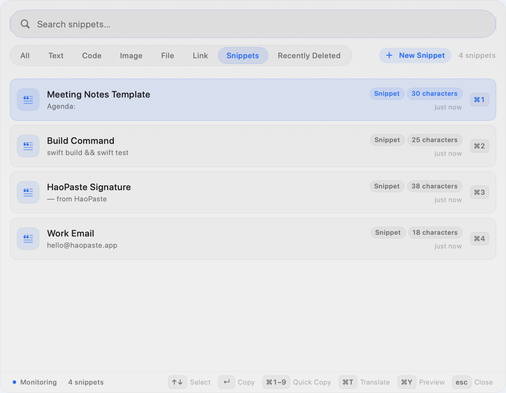

Open the **Snippets** tab in the panel and click **New Snippet**, or right-click any text item and choose **Save as Snippet…**. Manage snippets in **Settings → Snippets**:

- Search titles or content
- Use `↑` `↓` to select and `↵` or `⌘1–9` to copy
- Click a row to copy
- Snippets never enter clipboard history or count toward the history limit
- Backups include snippets automatically

### Preview and drag

| Image preview | Rich-text preview |
| --- | --- |
| 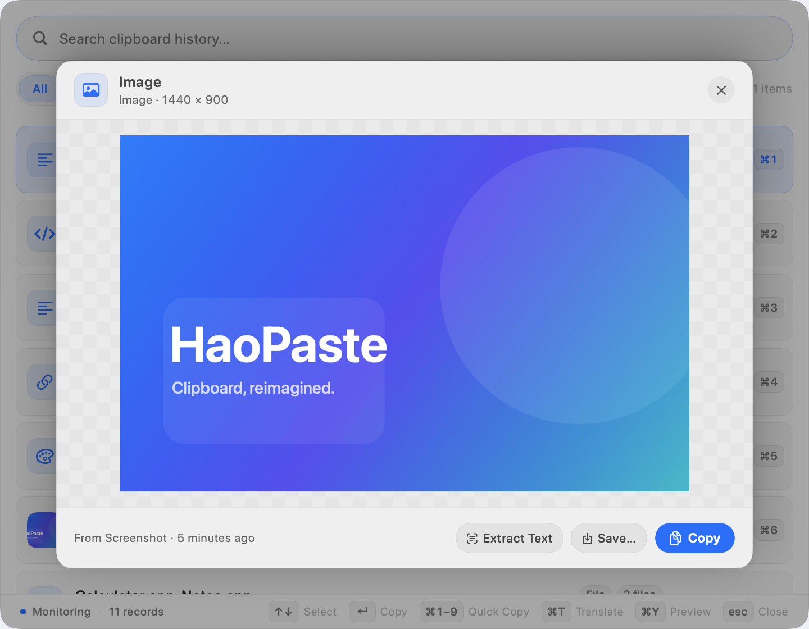 | 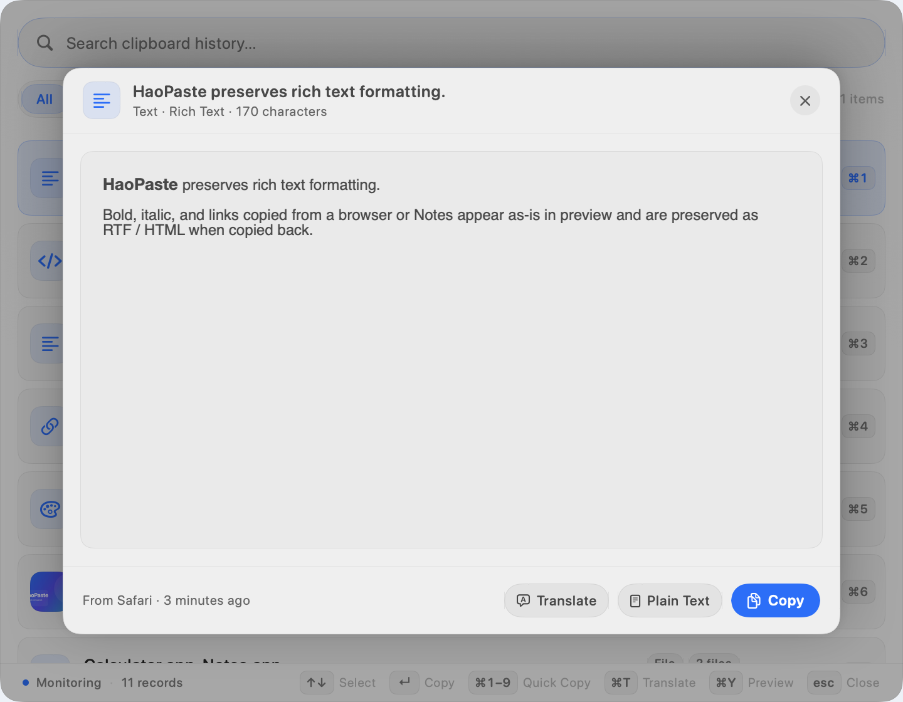 |

- Click the eye button while hovering, or press `⌘Y`, to open a large image or full-text preview.
- Images use their original ratio with a transparency checkerboard; drag them to other apps or save as PNG.
- Text and code show their full content and are selectable. Rich text renders RTF / HTML formatting.
- Color items show a large swatch with HEX / RGB / HSL. File items list paths and support per-file drag.
- Use `↑` `↓` to switch items in preview, `↵` to copy and close, and `esc` to return.

### Multi-select and merge

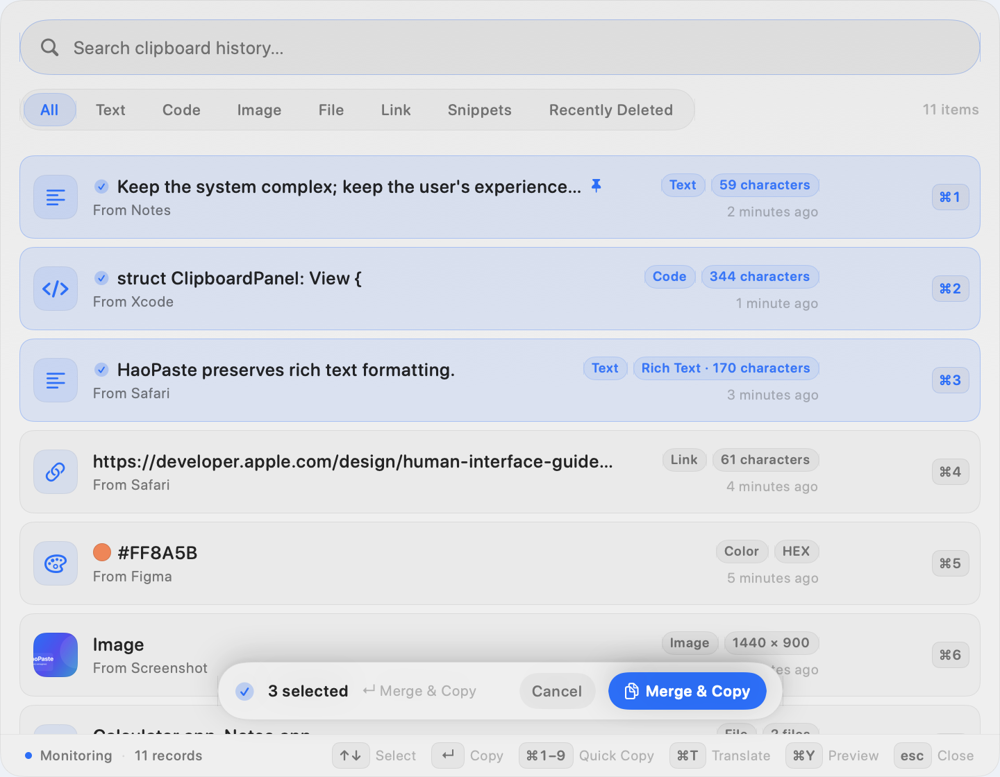

- `⌘`-click to toggle selection, `⇧`-click to select a range.
- `⇧↑` / `⇧↓` extend the selection; `⌘⇧A` selects all current results.
- With two or more items selected, a floating action bar appears. Press `↵` or click **Merge & Copy**.
- Text / code / links / colors merge into plain text in visible order, separated by newlines.
- Multiple file items copy as file URLs; mixed text and files include the file paths.
- Images cannot be merged yet and the action bar explains why.
- Merge results are not written to history. Press `esc` to cancel multi-select.

### Quick translation

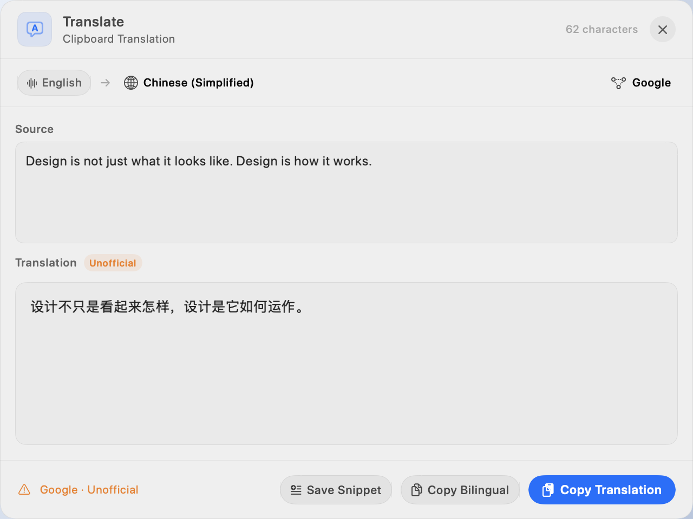

- Copy text in any app and press `⌥⌘T` to open a translation card without the main panel.
- The source language is detected automatically. Press `↵` to copy the translation and close, `esc` to close, or `⌘C` to copy.
- The menu bar menu also offers **Translate Clipboard**.
- Hover a text item to translate. Hover an image item to extract text; then use **Translate** in the OCR window.
- Change the shortcut in **Settings → General**.
- **Translate latest record when opening panel** is off by default. It only runs for the genuinely latest text that differs from the target language; pinned items and images are never treated as the latest auto-translate target.
- **Extract Text** in image preview runs local OCR only. Use **Translate** in the OCR window afterwards to translate the recognized text.

### Selection Translation (experimental)

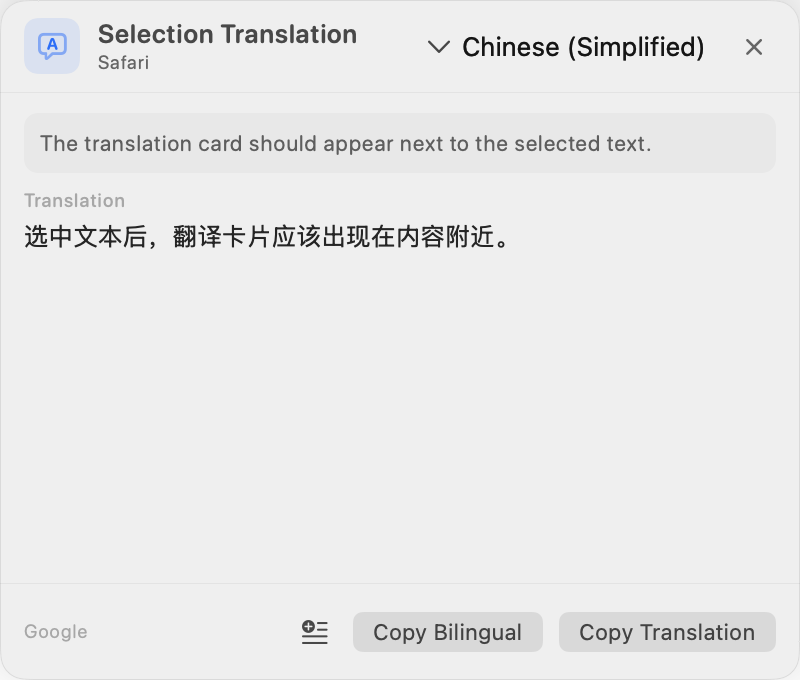

- Enable it in **Settings → Smart → Selection Translation**; off by default.
- Requires Accessibility permission.
- Select text with the mouse to show a small translate icon. Selected text is read and translated only after clicking the icon.
- The translation card opens near the selection instead of being fixed to the screen center.
- It never simulates `⌘C` or copies automatically; normal copy shortcuts keep working.
- Skipped in full-screen apps, secure input, excluded apps, and HaoPaste itself.
- This version supports mouse selection only; keyboard selection is planned.

### Translation engines

| Translation panel | Online consent |
| --- | --- |
| 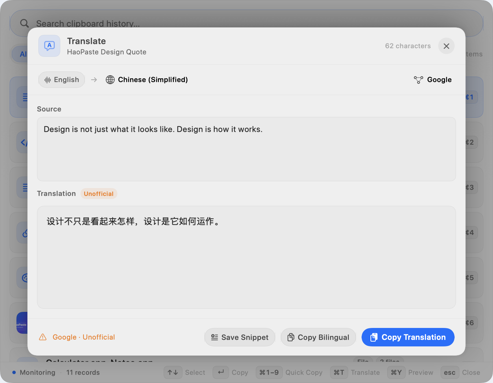 | 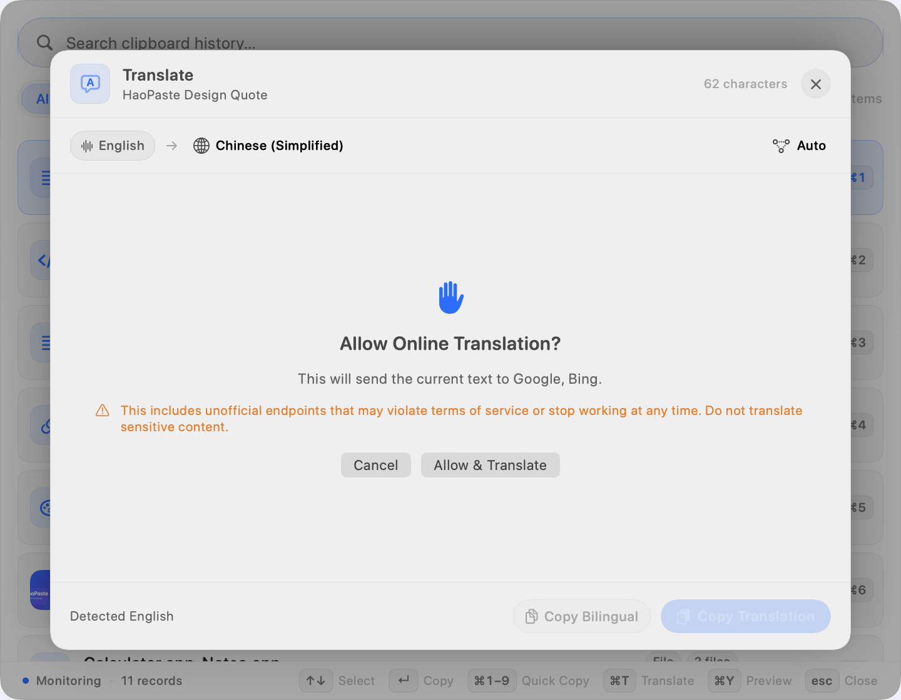 |

- Press `⌘T`, use **Translate** in preview, or choose **Translate…** from a context menu.
- Unofficial Google / Bing channels need no API key. DeepL unofficial is experimental.
- Official APIs: Azure Translator, DeepL API, Baidu Translate, and Google Cloud.
- **Settings → Smart** manages target language, engine priority, credentials, connection tests, and consent.
- The first online translation asks for consent explicitly; unofficial channels are labeled with their risks.
- Long text is translated in paragraph chunks. Copy the translation, copy both languages, or save it as a snippet.
- Online translation sends only the current text. Images, history, and files are never uploaded.

### Image text (OCR)

| Single image | Batch |
| --- | --- |
| 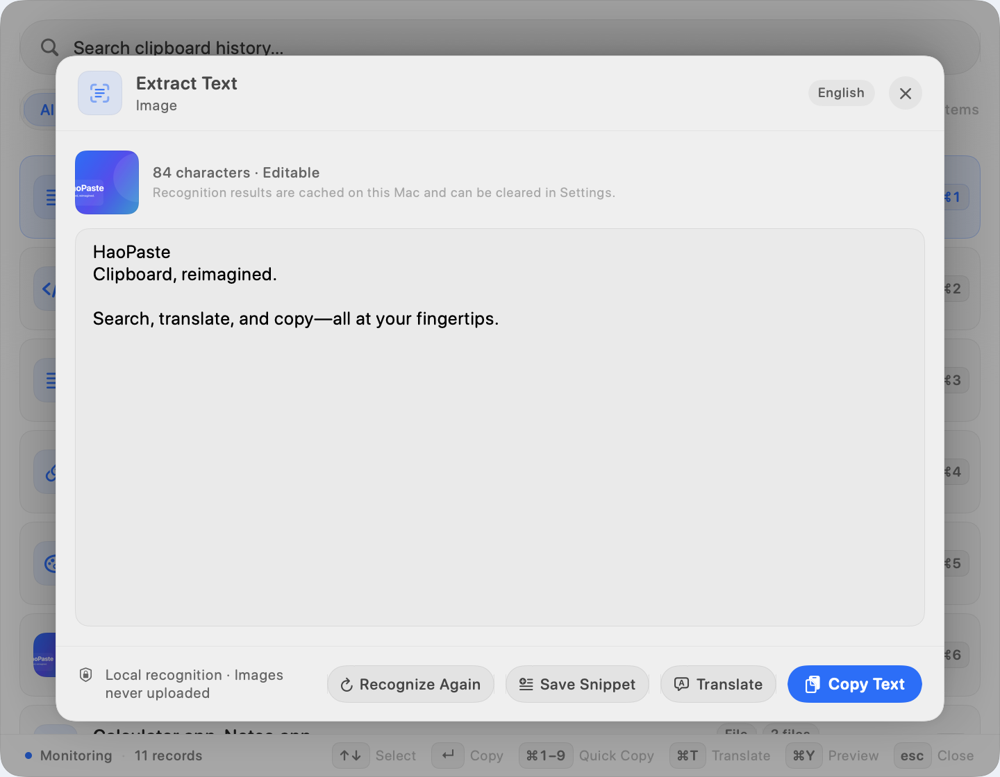 | 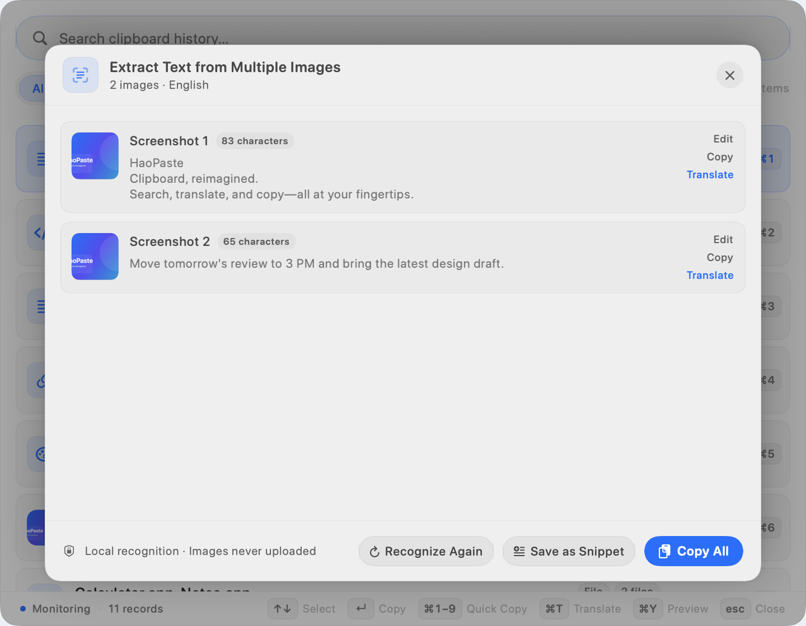 |

- Click **Extract Text** in image preview, choose **Extract Text…** from the context menu, or press `⌘R`.
- Uses macOS Vision locally. Images are never uploaded.
- Recognition results are editable, copyable, and can be saved as snippets.
- Click **Translate** to send recognized text to the translation panel with the configured engines.
- Results are cached locally by image content and language. Clear the cache in Settings.
- Select two or more images and use **Recognize Text** in the action bar for batch recognition.
- OCR language can be auto-detect, Simplified Chinese, Traditional Chinese, English, or Japanese.
- Works well for screenshots, scans, and text in design mockups.

## Features

- **System-wide access**: default `⌥⌘V` global shortcut or the menu bar clipboard icon. The shortcut is configurable.
- **Clipboard Shelf (top / left / right)**: slide-in animation, All / Text / Image filters, 6 / 8 / 10 / 12 / Unlimited load limits, two-axis scrolling, dynamic card height, gold clip deletion, in-place preview / translation, context menus, and drag export.
- **Borderless floating panel**: `.regularMaterial` blur, 16pt continuous corners, 0.5pt hairline border, and soft shadow.
- **Instant search**: search content, source app, type, or format with Chinese, Pinyin full / initial abbreviations, and fuzzy matching ranked by relevance.
- **Category pills**: All / Text / Code / Image / File / Link / Snippets with a smooth sliding selection.
- **Keyboard-first workflow**:

  | Shortcut | Action |
  | --- | --- |
  | `↑` `↓` | Move selection |
  | `⇧↑` `⇧↓` | Extend multi-selection from the anchor |
  | `⌘⇧A` | Select all current results |
  | `↵` | Copy selected item; merge and close when multi-selecting |
  | `⌘1` – `⌘9` | Copy the item at that position |
  | `⌘P` | Pin / unpin |
  | `⌘Y` | Open / close preview |
  | `⌥⌘T` | Translate the current clipboard text globally |
  | `⌘T` | Translate selected text; OCR on an image; close the translation panel |
  | `⌘R` | Recognize text in the selected image |
  | `⌘⌫` | Delete selected item |
  | `esc` | Cancel multi-select → clear search → close panel |

- **Card interactions**: hover highlight, 1pt lift, spring animation, pin / delete controls, and context menus.
- **Click-away dismissal**: closes when clicking outside or switching apps.
- **Settings**: global shortcuts, launch at login, pause monitoring, history capacity, shelf toggle / edge / load limit, clear history, open data folder, panel / shelf copy behavior, and backups.
- **Privacy controls**: exclude apps, disable image capture, and always-on hidden / transient / password-manager type filtering.
- **Backup & migration**: export history, images, and snippets to an unencrypted `.zip`; import merges, deduplicates, and preserves pinned state.
- **Smart classification**: text, link, code / JSON, HEX color, image, and file.
- **File support**: copy one or many files / folders from Finder; copy back, reveal in Finder, and get clear missing-file warnings.
- **Drag export**: drag text, image, or file items into other apps; multi-file items drag all files at once from the file icon.
- **Quick actions**: open links / files, save images, copy Markdown links, and copy RGB / HSL color formats.
- **Rich text preservation**: RTF / HTML from browsers and Notes is stored and restored on copy, with an explicit plain-text option.
- **Color visualization**: real swatches for HEX items with HEX / RGB / HSL copies.
- **Source app labels**: records the frontmost app when content was copied.
- **Image thumbnails**: original and thumbnail files are cached separately; lists only load thumbnails.
- **Safe filtering**: ignores `org.nspasteboard.ConcealedType`, transient types, generated types, and private password-manager types.
- **Deduplication**: identical content refreshes the existing record and moves it to the top; pinned state is preserved.
- **History limit**: unpinned history defaults to 200 items with FIFO eviction. Configure it in Settings; pinned items are never removed automatically.
- **Native details**: follows light / dark appearance and accent color; copy success and pin actions use subtle spring / SF Symbol bounce feedback, Reduce Motion is respected, and icons use hierarchical SF Symbols.
- **Selection Translation (experimental)**: off by default; mouse selection shows an icon, and clicking it reads the selection and opens a nearby translation card. No simulated ⌘C and no automatic copying; full-screen, secure input, and excluded apps are skipped.

Clicking an item only copies it. HaoPaste does not paste automatically, so the core clipboard features need no Accessibility permission. The optional Selection Translation feature requires Accessibility permission to read the selected text when enabled.

### Settings

| General | Smart |
| --- | --- |
| 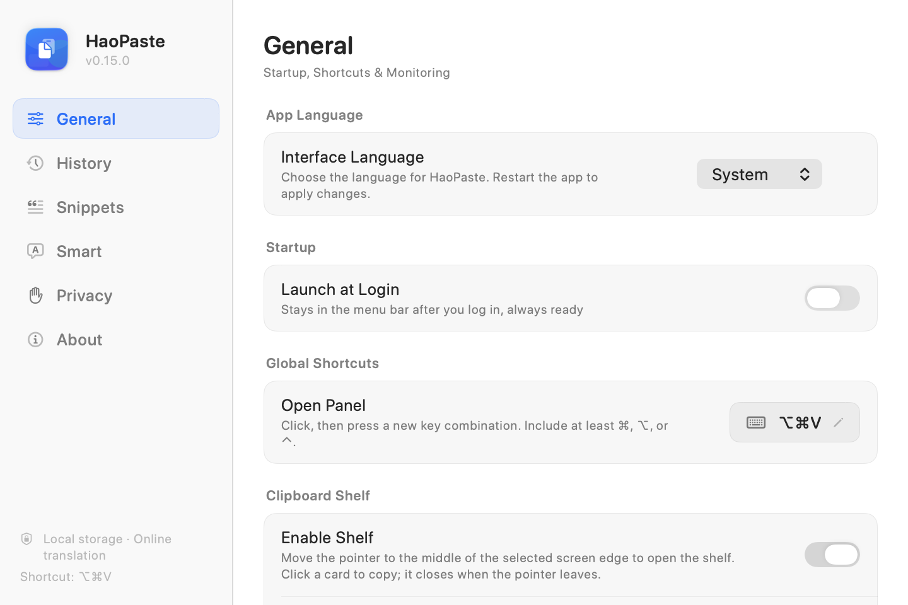 | 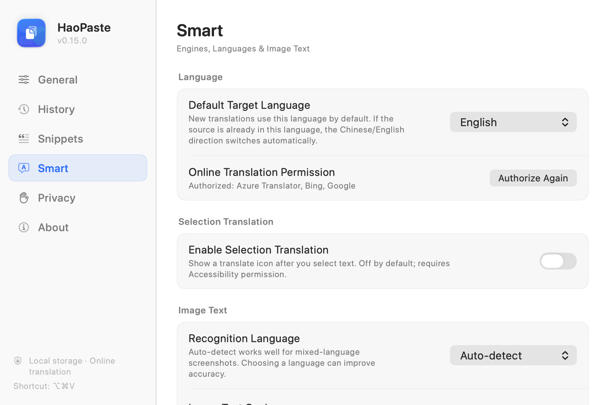 |

Open with the menu bar context menu → **Settings…**, or press `⌘,`.

- **General**: launch at login, panel / translation shortcuts, auto-translate latest item, copy behavior, pause / resume monitoring.
- **History**: 100 / 200 / 500 / 1000 unpinned limit, clear unpinned or all history, reveal the data folder, export / import backups.
- **Snippets**: create, edit, and delete reusable text; snippets are not clipboard history.
- **Smart**: default target language, engine priority, official API credentials, connection tests, and online translation consent.
- **Privacy**: disable image capture and exclude apps. New clipboard content from excluded apps is never recorded.
- **About**: version, shortcuts, privacy, and permission information.

### Language

HaoPaste follows the system language by default:

- Chinese system languages use Simplified Chinese
- English system languages use English
- All other system languages fall back to English

You can override this in **Settings → General → App Language** by choosing **System**, **简体中文**, or **English**. Click **Restart Now** to apply the change.

Localization resources live in `HaoPaste/en.lproj` and `HaoPaste/zh-Hans.lproj`. Source strings are Chinese and are used as lookup keys through `L()`.

## Build and develop

Requirements: macOS 14+ and Xcode 15+ (the project is verified with Xcode 26.5).

```bash
# Development
make run       # debug build and launch
make demo      # launch with reproducible sample data
make test      # run 124 XCTest cases

# Release
make release   # release build
make dmg       # dist/HaoPaste-<version>.dmg
make screenshots        # regenerate Chinese and English README screenshots
make verify-screenshots # compare screenshots with committed baselines
make install   # install to /Applications and launch
```

You can also open `HaoPaste.xcodeproj` directly. The project is generated by [XcodeGen](https://github.com/yonaskolb/XcodeGen) from `project.yml`; run `make project` or `xcodegen generate` after adding source files.

HaoPaste stays in the menu bar after launch. Press `⌥⌘V` to open the panel. See the [Development & Release guide](Docs/DEVELOPMENT.md) (Chinese) for build, signing, and notarization details.

## Quality and tests

- **124 XCTest cases** cover content classification, shortcut models, history models, settings persistence, privacy exclusions, files and rich text, color parsing, Pinyin / fuzzy search, snippets, preview / drag, multi-select / merge, translation engines / fallback / consent, quick translation / auto-translate policy, shelf layout / scrolling / filtering / hit testing / action bar, OCR / batch recognition / cache, deduplication / trimming, storage I/O, and backup import / export.
- The test host skips the menu bar, clipboard polling, and global hotkey registration so tests do not affect normal use.
- GitHub Actions: `.github/workflows/ci.yml` runs tests and a Release build; `.github/workflows/release.yml` runs tests, builds the DMG, creates the GitHub Release, and uploads assets when a `v*` tag is pushed.
- Run with `make test`.

## Keyboard and interaction details

- Typing in search filters instantly. While multi-selecting, `esc` first cancels the selection, then clears search, then closes the panel.
- The panel closes when it loses focus and restores focus to the previous app.
- Hovering an item reveals translate, preview, pin, and delete controls. Clicking the body copies.
- Press `⌘Y` to preview; `esc` returns and `↵` copies and closes.
- Hold `⌘` and click to toggle multi-select; hold `⇧` and click for a contiguous range. The merge action bar appears at the bottom.
- Press `⌘T` to translate selected text. In the translation panel, `esc` returns and `↵` copies the translation and closes.
- Press `⌘R` or `⌘T` on an image to run OCR. Recognized text is editable and can be translated.
- `⌘1`–`⌘9` map to the first nine items in the current filtered result.

## Data and persistence

HaoPaste uses lightweight JSON with no third-party runtime dependencies:

```text
~/Library/Application Support/HaoPaste/
├── history.json          # [ClipboardItem]
├── snippets.json         # [Snippet]
├── Images/
│   ├── <UUID>.png        # original
│   └── <UUID>-thumb.png  # list thumbnail
└── RichText/
    └── <UUID>.json       # RTF / HTML cache
```

Exported backups are unencrypted zip files:

```text
HaoPasteBackup/
├── manifest.json        # schema, version, exportedAt, counts
├── history.json         # all records, pinned state, source apps
├── snippets.json        # all snippets
├── Images/              # originals and thumbnails
└── RichText/            # RTF / HTML cache
```

For development and testing, override storage with an environment variable or launch argument:

```bash
HAOPASTE_STORAGE_DIR=/tmp/haopaste-dev ./HaoPaste.app/Contents/MacOS/HaoPaste
# or
open -n HaoPaste.app --args --storage /tmp/haopaste-dev
```

Core model:

```swift
struct ClipboardItem {
    let id: UUID
    var type: ClipboardItemType         // .text / .image / .file / .colorHex / .url / .code
    var content: String                 // text, or image file name
    var plainText: String               // searchable / plain-text output
    var isPinned: Bool
    var createdAt: Date
    var sourceApp: SourceApplication?   // bundle ID + name
    var contentHash: String             // SHA-256 dedup fingerprint
    var imageFileName: String?
    var thumbnailFileName: String?
    var imageDimensions: ImageDimensions?
    var filePaths: [String]?            // single / multiple .file paths
    var richTextFileName: String?       // RichText cache file
}
```

## Architecture

```text
HaoPaste/
├── App/
│   ├── HaoPasteApplication.swift        # AppKit entry, menu bar app
│   ├── AppDelegate.swift                # dependency wiring, main menu, debug entry
│   ├── PanelController.swift            # NSPanel, positioning, key events, focus restore
│   ├── QuickTranslationPanelController.swift # quick translation card
│   ├── ClipboardShelfController.swift   # shelf triggers, polling, click-through
│   ├── ClipboardShelfPanel.swift        # transparent non-activating shelf panel
│   ├── ShelfPreviewPanelController.swift
│   ├── ShelfOCRPanelController.swift
│   ├── ShelfDetailPanel.swift
│   ├── GlobalHotKey.swift               # Carbon global hotkeys
│   ├── SettingsWindowController.swift   # settings window host
│   └── StatusBarController.swift        # menu bar icon and context menu
├── Services/                            # clipboard, storage, search, translation, OCR, archive
├── Models/                              # clipboard item, shelf layout, snippets, translation models
├── State/                               # panel and shelf interaction state
├── Views/                               # panel, preview, translation, OCR, shelf, settings
├── Utilities/                           # image save panel and localization
├── Theme/Theme.swift                    # corners, spacing, springs, hairlines
└── Support/                             # demo data and off-screen renderer (Debug only)
```

### Monitoring flow

1. Compare `NSPasteboard.general.changeCount` every 350ms.
2. On change, filter hidden / transient / password-manager types first.
3. Try file URLs, images, then plain text. For text, read RTF / HTML and include it in the SHA-256 fingerprint.
4. Compare with existing history fingerprints: refresh and move to top on a match; otherwise create a new record.
5. Write images to disk and generate thumbnails; persist JSON with a 400ms debounce.
6. Trim unpinned history to the configured limit; pinned records are always kept.

### Copy flow

HaoPaste synchronizes `changeCount` immediately after writing to the pasteboard, so copying a history item does not create a duplicate record. It also refreshes the item's usage time so it appears earlier next time. Rich-text items write plain text, RTF, and HTML; the context menu can copy plain text only.

## Debug rendering

Debug builds include off-screen rendering flags for visual QA:

```bash
# Panel screenshot (launch through Launch Services first)
open -n .build/Build/Products/Debug/HaoPaste.app --args --render /tmp/panel.png --storage /tmp/haopaste-preview

# Dark appearance
launchctl setenv HAOPASTE_RENDER_APPEARANCE dark
open -n .build/Build/Products/Debug/HaoPaste.app --args --render /tmp/panel-dark.png --storage /tmp/haopaste-preview-dark
launchctl unsetenv HAOPASTE_RENDER_APPEARANCE

# Preview (image / text), multi-select, translation, quick translation, shelf, OCR
```

`make demo` is equivalent to launching a Debug instance with `--demo --show --storage /tmp/haopaste-demo`.

## Documentation

| Document | Contents |
| --- | --- |
| [User Guide](Docs/USER_GUIDE.md) | Install, launch, shortcuts, menu bar, uninstall, FAQ (Chinese) |
| [Architecture](Docs/ARCHITECTURE.md) | Stack, modules, data flow, design, privacy, performance (Chinese) |
| [Development](Docs/DEVELOPMENT.md) | Build, debug flags, DMG, signing, notarization, release checklist (Chinese) |
| [Roadmap](Docs/ROADMAP.md) | Version plans, priorities, technical debt, acceptance criteria (Chinese) |
| [Handoff](Docs/HANDOFF.md) | Release automation, versioning, localization, English screenshots, AI handoff prompt (Chinese) |

## Known limitations

- File items store path references, not file contents. Moved or deleted files show as unavailable.
- Multi-image lists and GIFs are not supported yet.
- Multi-file items drag all files from the file icon; preview still drags files individually.
- Long-text preview renders the first 120,000 characters; copying always uses the full content.
- Merge supports text and files only. Images show an explanation; rich text merges as plain text.
- Merge results are not written to clipboard history and do not reorder source items.
- Translation applies to text / rich text only. Code, URLs, colors, images, and files have no translation entry point.
- Unofficial Google / Bing endpoints have no public contract and may be rate-limited or stop working. DeepL unofficial is currently limited by the server-side client version; the official API is recommended.
- Online translation sends the current text to the selected engine. API keys are stored in the Keychain and excluded from backups.
- **Translate latest record when opening panel** is off by default. When enabled, it translates only the genuinely latest text that differs from the target language; pinned items are not mistaken for the latest record.
- Apple offline translation is not integrated yet (macOS 15+ language packs need separate validation).
- OCR results are cached locally in `OCR/` by image and language and are not included in backups by default. Clear them in **Settings → Smart**.
- Batch OCR runs sequentially. Scanned PDFs are not supported.
- The quick translation shortcut handles plain clipboard text only. For images, extract text first and then click **Translate** in the OCR window.
- Auto-translation handles text items only; it skips images, code, and text already in the target language.
- RTF and HTML are each capped at 2MB; larger payloads fall back to plain text.
- File items in backups are also path references and may be unavailable after moving to another Mac.
- Copy does not paste automatically, so no Accessibility permission is required for the core app. The optional Selection Translation feature does require it when enabled.
- The shelf uses one edge at a time. If the Dock occupies the left or right edge, use another edge.
- Shelf preview / translation / OCR cards float beside the shelf and do not open the main panel.
- iCloud sync is not implemented.
- Exported `.zip` backups contain full clipboard contents and are unencrypted. Store them safely.
- Launch at login uses `SMAppService`; macOS may require approval in **System Settings → General → Login Items**.
- Custom shortcuts use fixed key-name mapping; non-US keyboard layouts may display different characters.
- The app is signed ad-hoc. Public distribution still requires Developer ID signing and notarization. Selection Translation depends on Accessibility permission, which may need to be granted again after reinstalling an ad-hoc build.
- The app icon is generated by `Scripts/generate-app-icon.swift` and can be rebuilt.

See [ROADMAP.md](Docs/ROADMAP.md) for future plans.
