# HaoPaste

当前版本：**v0.9.1**

一款原生、轻快、键盘优先的 macOS 剪切板管理器。用 `⌥⌘V` 从任何应用呼出无标题栏悬浮面板，搜索、选择、复制，一气呵成。

> 设计目标：接近 Raycast / Paste 的精致感，同时保持 Apple Human Interface Guidelines 的原生语义与克制。

| 浅色 | 深色 |
| --- | --- |
| 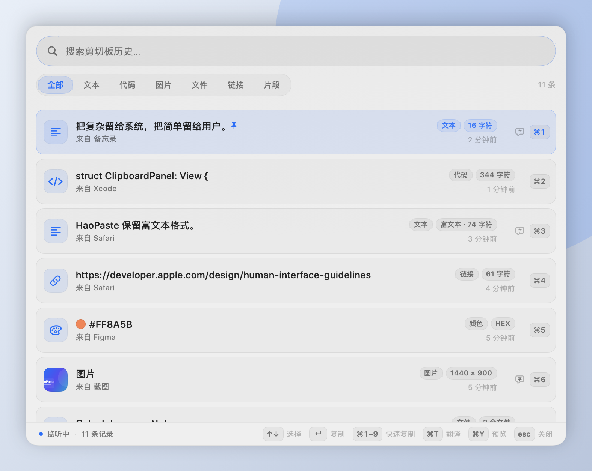 | 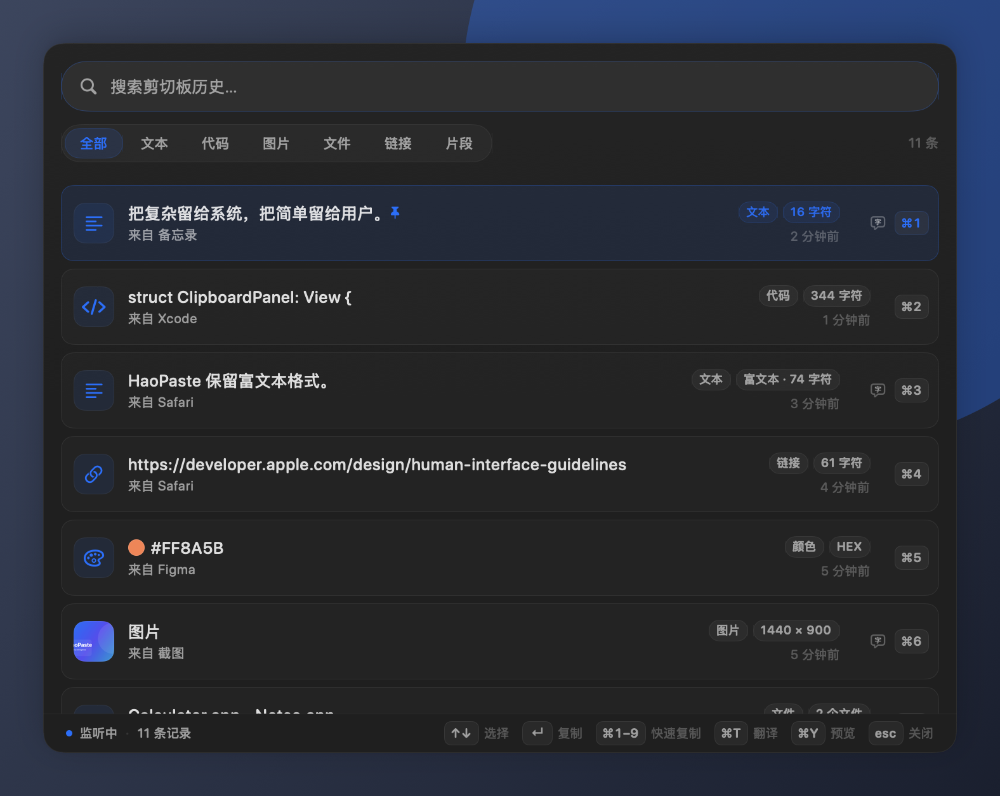 |

*界面预览使用示例数据，由应用内置的离屏渲染工具生成。*

---

## 安装使用（无需 Xcode）

1. 构建或获取安装包：

   ```bash
   make dmg
   # 输出：
   # dist/HaoPaste-0.9.1.dmg
   # dist/HaoPaste-0.9.1.dmg.sha256
   ```

2. 双击打开 `dist/HaoPaste-0.9.1.dmg`，将 **HaoPaste** 拖入 **Applications / 应用程序**。
3. 从“应用程序”或 Spotlight 启动。首次启动会自动展示一次面板。
4. 之后随时按 `⌥⌘V`，或点击菜单栏的剪贴板图标呼出；右键菜单栏图标可暂停监听、清空记录或退出。

HaoPaste 是 `LSUIElement` 菜单栏应用，**不会出现在 Dock**；启动后请查看菜单栏图标。

也可以直接安装到本机并启动：

```bash
make install     # 安装到 /Applications（不可写时回退 ~/Applications）
```

DMG 使用本地 ad-hoc 签名。若首次打开时被 Gatekeeper 拦截，请在 Finder 中右键应用 → **打开**。

详细的安装、退出、卸载和 FAQ 见 [用户指南](Docs/USER_GUIDE.md)。

### Snippets 片段

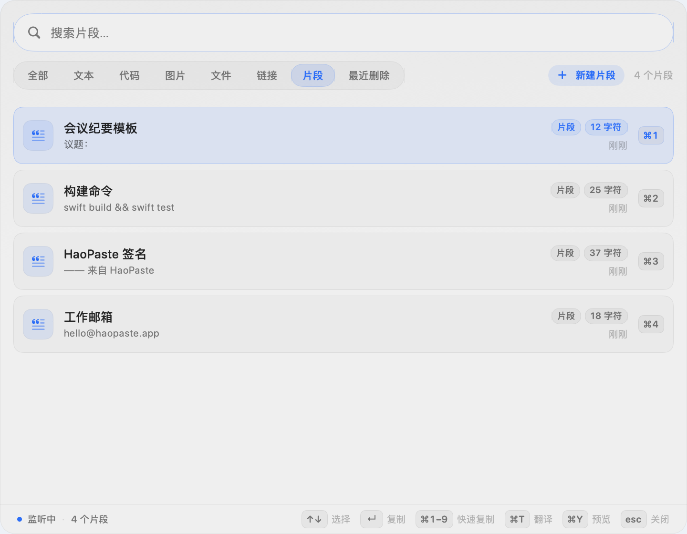

在 **设置 → 片段** 中创建名称和内容，然后在面板切换到「片段」标签：

- 搜索片段标题或内容
- `↑` `↓` 选择，`↵` 或 `⌘1–9` 一键复制
- 点击行也可以复制
- 片段不会写入剪贴板历史，也不会占用历史上限
- 备份包会自动包含片段

### 快速预览与拖拽

| 图片预览 | 富文本预览 |
| --- | --- |
| 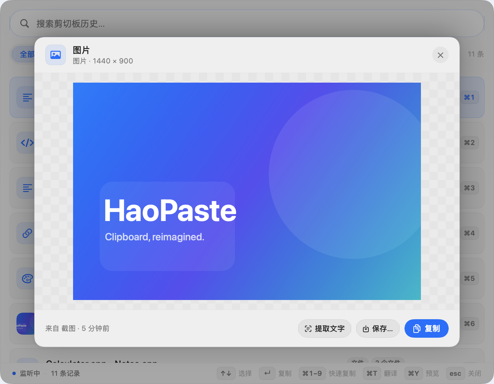 | 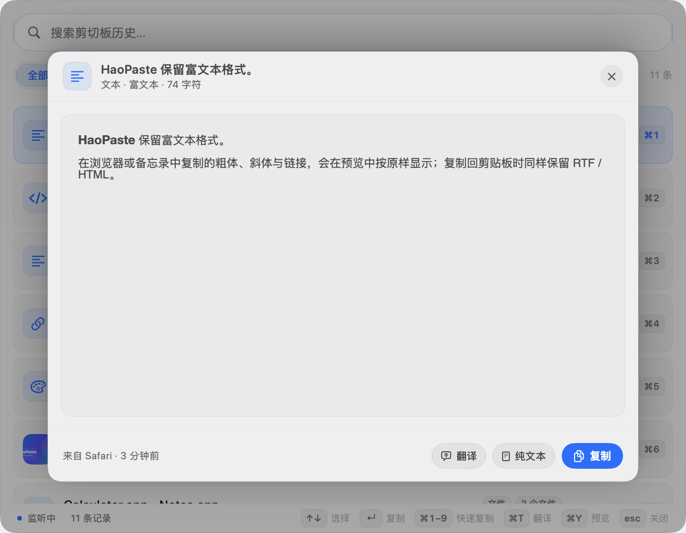 |

- 悬停条目点击眼睛按钮，或选中后按 `⌘Y`，打开大图 / 全文预览
- 图片按原始比例展示，带透明棋盘格；可拖拽到其他应用，或直接保存为 PNG
- 文本与代码显示完整内容并支持选择；富文本按 RTF / HTML 渲染粗体、斜体等格式
- 颜色条目显示大色块与 HEX / RGB / HSL；文件条目列出路径并支持逐个拖拽
- 预览中 `↑` `↓` 切换条目，`↵` 复制并关闭，`esc` 返回列表

### 多选与合并复制

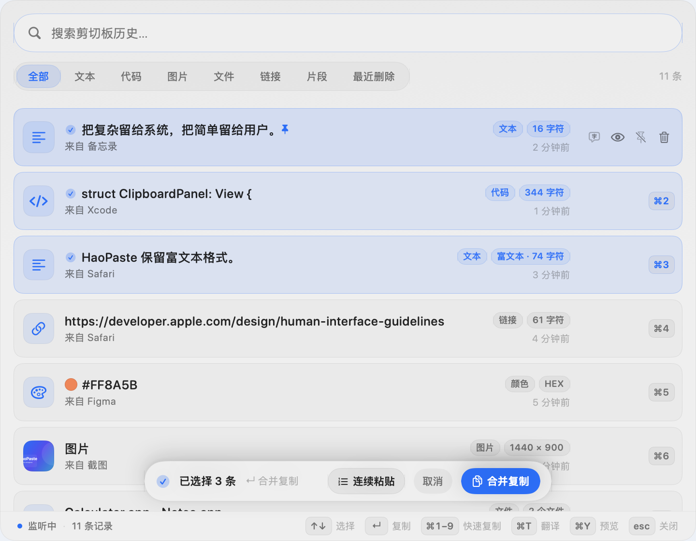

- `⌘`-点击切换多选，`⇧`-点击选择连续范围
- `⇧↑` / `⇧↓` 扩展选择，`⌘⇧A` 全选当前结果
- 选中 2 条以上后出现浮动操作条，按 `↵` 或点击「合并复制」
- 文本 / 代码 / 链接 / 颜色按可见顺序用换行合并为纯文本
- 全部为文件时复制多个文件 URL；文本与文件混合时附带文件路径
- 图片暂不支持合并，操作条会明确提示
- 合并结果不会写入历史；`esc` 取消多选

### 快捷翻译


- 在任意应用复制文本，按 `⌥⌘T` 直接呼出翻译卡片，无需打开主面板
- 卡片自动检测源语言并开始翻译；`↵` 复制译文并关闭，`esc` 关闭，`⌘C` 复制
- 菜单栏右键新增「翻译剪贴板」入口
- 文本条目右侧常驻「翻译」按钮，图片条目常驻「识图并翻译」按钮
- 设置 → 通用可修改快捷翻译快捷键
- 可开启「打开面板时翻译最新记录」：默认开启，仅对**新的、与目标语言不同**的文本自动执行，每条记录只自动一次；图片不会自动翻译
- 图片预览新增「识图并翻译」：先本地 OCR，再自动进入翻译

### 翻译与多引擎

| 翻译面板 | 在线授权 |
| --- | --- |
|  | 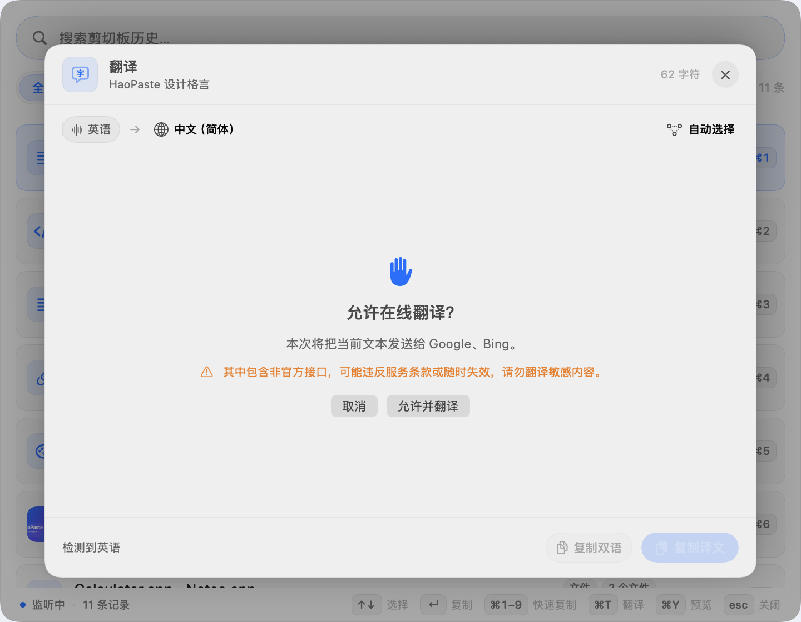 |

- `⌘T`、预览底部「翻译」或右键「翻译…」打开翻译面板
- 支持 Google / Bing 非官方通道，无需 API Key；DeepL 非官方为实验性开关
- 支持官方 API：Azure Translator、DeepL API、百度翻译、Google Cloud
- 设置 → 智能：目标语言、引擎优先级、凭证配置、连接测试与授权管理
- 首次在线翻译会显式询问；非官方通道会标注风险
- 长文本按段落分块翻译；译文可复制、复制双语或保存为片段
- 在线翻译只发送当前待翻译文本，图片、历史和文件不会上传

### 识图与文字提取

| 单张识图 | 批量识图 |
| --- | --- |
| 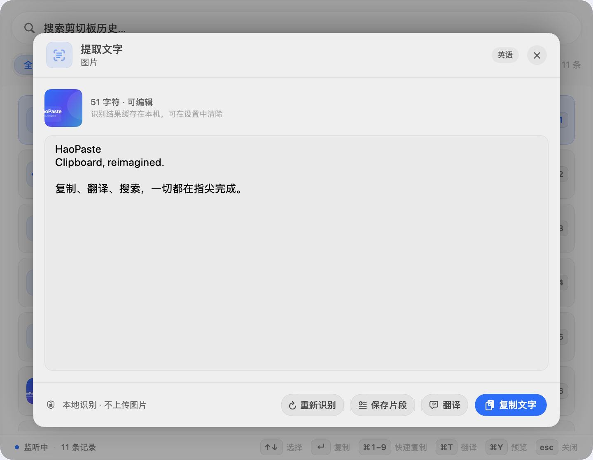 | 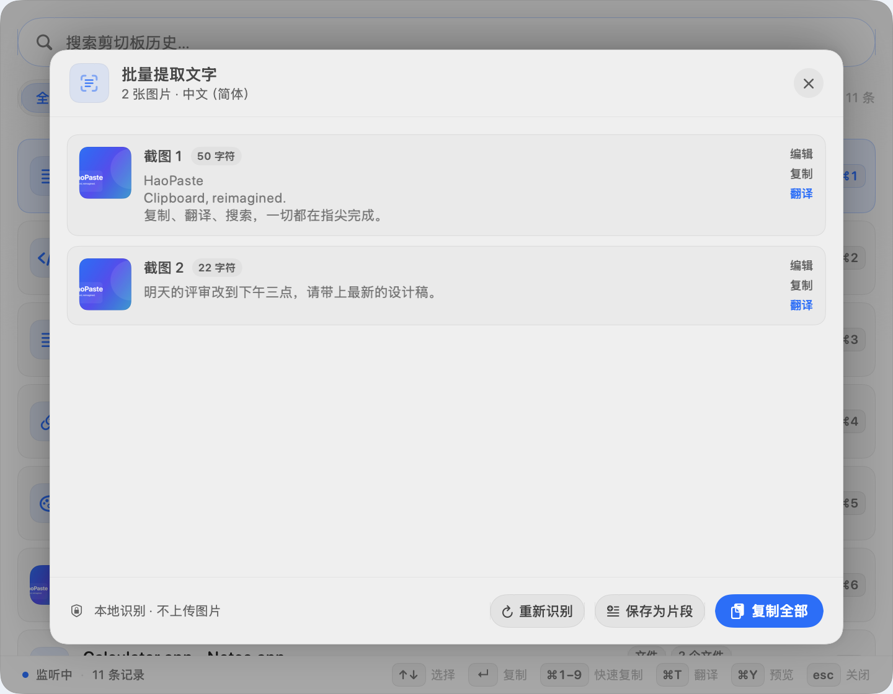 |

- 在图片预览底部点击「提取文字」，或右键图片选择「提取文字…」，也可按 `⌘R`
- 使用 macOS Vision 在本地识别，图片不会上传
- 识别结果可编辑、可复制、可保存为片段
- 点击「翻译」可直接把识别文字送入翻译面板，复用已配置的翻译引擎
- 识别结果按图片内容与语言缓存在本机，重新打开无需再次识别；可在设置中清除
- 多选 2 张以上图片后，底部操作条会出现「识别文字」，可批量识别并复制全部结果
- 设置 → 智能可选择自动检测 / 中文 / 英语 / 日语识别语言
- 适合截图、扫描图、设计稿等图片中的文字提取

## 功能

- **系统级唤起**：默认 `⌥⌘V` 全局快捷键，或点击菜单栏剪贴板图标；快捷键可在设置中录入修改。
- **无标题栏悬浮面板**：`.regularMaterial` 磨砂背景、16pt 连续圆角、0.5pt 细描边、柔和阴影。
- **即时搜索**：按内容、来源应用、类型或格式搜索；支持中文、拼音全拼 / 首字母缩写与模糊匹配，并按相关性排序。
- **分类药丸**：全部 / 文本 / 代码 / 图片 / 文件 / 链接 / 片段，胶囊选中态平滑滑动。
- **键盘优先**：

  | 快捷键 | 行为 |
  | --- | --- |
  | `↑` `↓` | 切换选中条目 |
  | `⇧↑` `⇧↓` | 从锚点扩展多选范围 |
  | `⌘⇧A` | 全选当前结果 |
  | `↵` | 复制选中条目；多选时合并复制并关闭面板 |
  | `⌘1` – `⌘9` | 直接复制对应序号的条目 |
  | `⌘P` | 置顶 / 取消置顶 |
  | `⌘Y` | 打开 / 关闭选中条目的预览 |
  | `⌥⌘T` | 全局翻译当前剪贴板文本（可在设置中修改） |
  | `⌘T` | 翻译选中文本；图片上打开识图；翻译面板中按 `⌘T` 关闭 |
  | `⌘R` | 识别选中图片中的文字 |
  | `⌘⌫` | 删除选中条目 |
  | `esc` | 多选时取消多选；有搜索词时清除搜索；否则关闭面板 |

- **卡片交互**：悬停高亮、1pt 微位移、弹簧动效；悬停后显示置顶与删除按钮；支持右键菜单。
- **点击外部关闭**：点击面板外侧、透明阴影留白区域或切换到其他应用时自动收起。
- **设置窗口**：自定义全局快捷键、登录时自动启动、暂停监听、历史容量、清空记录、打开数据目录。
- **隐私控制**：按应用排除剪贴板记录、关闭图片记录；隐藏类型过滤始终开启。
- **备份与迁移**：将历史、图片与片段导出为 `.zip`，导入时自动合并、去重并保留置顶状态。
- **智能识别**：自动区分纯文本、链接、代码 / JSON、颜色值（HEX）、图片与文件。
- **文件支持**：从 Finder 复制单个或多个文件/文件夹；文件条目可复制回其他应用，右键可在 Finder 中显示；文件丢失时会明确提示。
- **快捷动作**：右键打开链接 / 文件、保存图片、复制 Markdown 链接、复制颜色的 RGB / HSL 表示。
- **快速预览**：`⌘Y` 或悬停眼睛按钮打开预览；支持图片大图、全文 / 富文本、颜色色块与文件列表。
- **拖拽导出**：把文本、图片或单个文件条目直接拖到其他应用；预览中的图片与文件行同样可拖拽。
- **多选合并**：`⌘`-点击或 `⇧`-点击多选，按 `↵` 将多条文本合并复制；多个文件条目复制为文件 URL 列表。
- **翻译**：`⌘T` 或预览中的「翻译」打开翻译面板；支持非官方 Google / Bing 与官方 Azure / DeepL / 百度 / Google Cloud，多引擎自动回退。
- **快捷翻译**：`⌥⌘T` 从任意应用直接翻译当前剪贴板文本；菜单栏、行内悬停按钮与「识图并翻译」提供更多入口。
- **识图**：Vision 本地 OCR，支持单张与批量识别、编辑、复制、保存片段或直接翻译；结果本地缓存。
- **Snippets 片段**：在设置中管理常用文本与模板，面板「片段」标签中搜索、键盘选择并一键复制；不会写入历史。
- **富文本保留**：从浏览器 / 备忘录等复制的 RTF / HTML 格式会随内容保存，复制时优先保留格式；右键可复制为纯文本。
- **颜色可视化**：HEX 条目显示真实颜色色块，支持复制 HEX / RGB / HSL。
- **来源应用**：记录复制内容时最前方的应用名称。
- **图片缩略图**：原图与缩略图分文件缓存，列表只加载缩略图。
- **安全过滤**：忽略 `org.nspasteboard.ConcealedType`、临时类型、自动生成类型以及常见密码管理器的私有类型。
- **去重**：相同内容不会产生重复记录，而是刷新时间并回到顶部；置顶状态保留。
- **历史限制**：未置顶记录默认最多 200 条，FIFO 自动淘汰；可在设置中调整，置顶记录永不自动清理。
- **原生适配**：跟随系统浅色 / 深色外观与强调色，尊重“减弱动态效果”，全部图标使用 SF Symbols 分层渲染。

点击条目只执行「复制」，不会自动粘贴到上一个应用，因此应用不需要辅助功能（Accessibility）权限。

### 设置窗口

| 通用 | 智能 |
| --- | --- |
| 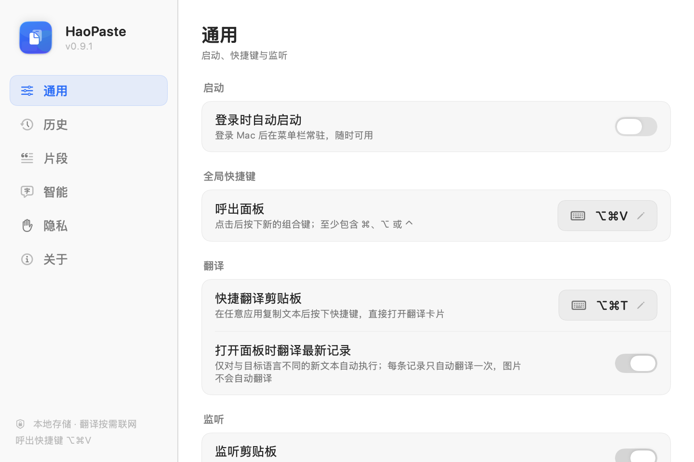 | 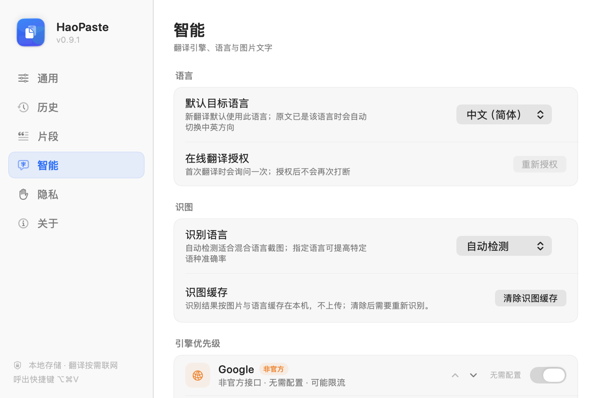 |

打开方式：右键菜单栏图标 → **设置…**，或按 `⌘,`。

- **通用**：登录时自动启动、录制呼出面板与快捷翻译快捷键、打开面板自动翻译最新记录、暂停 / 恢复监听。
- **历史**：100 / 200 / 500 / 1000 条未置顶记录上限、清空未置顶或全部记录、在 Finder 中打开数据目录；导出 / 导入完整历史与片段备份。
- **智能**：默认目标语言、翻译引擎优先级、官方 API 凭证配置与连接测试、在线翻译授权。
- **隐私**：关闭图片记录、排除指定应用（从“应用程序”选择），被排除应用的新复制内容不会入库。
- **关于**：版本、快捷键、隐私与权限信息。

## 开发运行

环境要求：macOS 14+、Xcode 15+（本工程使用 Xcode 26.5 构建验证）。

```bash
# 开发调试
make run       # Debug 构建并打开
make demo      # 用可复现的示例数据启动，便于查看界面
make test      # 运行 91 个 XCTest（自动化测试）

# 日常使用 / 发布
make release   # Release 构建
make dmg       # 生成 dist/HaoPaste-<version>.dmg
make install   # 安装到 /Applications 并启动
```

也可以直接打开 `HaoPaste.xcodeproj` 运行。工程由 [XcodeGen](https://github.com/yonaskolb/XcodeGen) 从 `project.yml` 生成；新增源文件后运行 `make project` 或 `xcodegen generate` 重新生成工程。

首次启动后，应用会驻留在菜单栏。按 `⌥⌘V` 呼出面板。详细构建、签名与公证流程见 [开发与发布文档](Docs/DEVELOPMENT.md)。

## 质量与测试

- **91 个 XCTest** 覆盖内容分类、快捷键模型、历史模型、设置持久化、隐私排除、文件与富文本、颜色解析、拼音 / 模糊搜索、Snippets、预览 / 拖拽、多选 / 合并、翻译引擎 / 回退 / 授权、快捷翻译 / 自动翻译策略、OCR / 批量识别 / 缓存、去重/裁剪、存储读写、备份导入导出。
- 测试宿主会自动跳过菜单栏、剪贴板轮询和全局快捷键注册，不影响正常使用。
- GitHub Actions 工作流：`.github/workflows/ci.yml`，在 macOS 上执行测试并构建 Release。
- 运行：`make test`。

## 快捷键与交互细节

- 在搜索框中输入会即时过滤；多选时 `esc` 先取消多选，之后清空搜索，最后关闭面板。
- 面板失焦时自动关闭，并把焦点还给之前的应用。
- 鼠标悬停在条目上显示预览、置顶与删除按钮；点击条目主体复制。
- 选中条目后按 `⌘Y` 打开预览；预览中按 `esc` 返回列表，按 `↵` 复制并关闭。
- 按住 `⌘` 点击条目切换多选，按住 `⇧` 点击选择连续范围；多选时底部出现合并操作条。
- 选中文本后按 `⌘T` 打开翻译；翻译面板中 `esc` 返回列表，`↵` 复制译文并关闭。
- 选中图片后按 `⌘R` 或 `⌘T` 打开识图；识别文字可直接编辑并翻译。
- 被选中条目使用系统强调色底色与边框，键盘与鼠标操作共享同一套选中状态。
- `⌘1`–`⌘9` 对应当前过滤结果中的前九条。

## 数据结构与持久化

使用轻量 JSON 存储，无第三方依赖：

```text
~/Library/Application Support/HaoPaste/
├── history.json          # [ClipboardItem]
├── snippets.json         # [Snippet]
├── Images/
│   ├── <UUID>.png        # 原图
│   └── <UUID>-thumb.png  # 列表缩略图
└── RichText/
    └── <UUID>.json       # RTF / HTML 缓存
```

导出的备份是一个未加密的 zip：

```text
HaoPasteBackup/
├── manifest.json        # schema、版本、导出时间、数量
├── history.json         # 全部记录（含置顶与来源应用）
├── snippets.json        # 全部片段
├── Images/              # 原图与缩略图
└── RichText/            # RTF / HTML 缓存
```

开发与测试可以通过环境变量或启动参数覆盖存储位置：

```bash
HAOPASTE_STORAGE_DIR=/tmp/haopaste-dev ./HaoPaste.app/Contents/MacOS/HaoPaste
# 或
open -n HaoPaste.app --args --storage /tmp/haopaste-dev
```

核心模型：

```swift
struct ClipboardItem {
    let id: UUID
    var type: ClipboardItemType         // .text / .image / .file / .colorHex / .url / .code
    var content: String                 // 文本内容，或图片文件名
    var plainText: String               // 搜索与纯文本输出
    var isPinned: Bool
    var createdAt: Date
    var sourceApp: SourceApplication?   // bundle ID + 名称
    var contentHash: String             // SHA-256 去重指纹
    var imageFileName: String?
    var thumbnailFileName: String?
    var imageDimensions: ImageDimensions?
    var filePaths: [String]?             // .file 的单个 / 多选路径
    var richTextFileName: String?        // RichText 缓存文件名
}
```

## 架构

```text
HaoPaste/
├── App/
│   ├── HaoPasteApplication.swift    # AppKit 入口，菜单栏驻留应用
│   ├── AppDelegate.swift            # 依赖装配、主菜单、调试入口
│   ├── PanelController.swift        # NSPanel、定位、键盘事件、焦点恢复
│   ├── QuickTranslationPanelController.swift # 快捷翻译浮动卡片
│   ├── GlobalHotKey.swift           # Carbon 全局快捷键（默认 ⌥⌘V）
│   ├── SettingsWindowController.swift # 设置窗口托管
│   └── StatusBarController.swift    # 菜单栏图标与右键菜单
├── Services/
│   ├── ClipboardMonitor.swift       # changeCount 轮询、隐藏类型过滤
│   ├── ClipboardManager.swift       # 去重、置顶、FIFO、复制、可观察状态
│   ├── ClipboardStore.swift         # JSON 持久化与图片资产
│   ├── HistoryArchiveService.swift  # zip 备份导出 / 合并导入
│   ├── AppSettings.swift            # 快捷键 / 历史上限 / 登录项偏好
│   ├── SnippetStore.swift           # snippets.json 持久化
│   ├── SnippetManager.swift         # 片段 CRUD / 过滤 / 合并
│   ├── ItemPreview.swift            # 预览文本 / 富文本构建
│   ├── ItemDragProvider.swift       # 拖拽粘贴板 Provider
│   ├── MergedContentBuilder.swift   # 多选内容合并规则
│   ├── SearchMatcher.swift          # 中文 / 拼音 / 模糊搜索
│   ├── ContentClassifier.swift      # 文本 / URL / JSON / 代码 / HEX 识别
│   ├── ContentHasher.swift          # SHA-256 指纹
│   ├── ImageProcessor.swift         # PNG 归一化与缩略图生成
│   ├── TranslationService.swift     # 翻译状态、回退、缓存与授权
│   ├── TranslationSettingsStore.swift # 目标语言与引擎优先级
│   ├── TranslationCredentialStore.swift # Keychain 凭证
│   ├── OCRService.swift             # Vision 本地文字识别、批量识别与状态
│   ├── OCRCacheStore.swift          # 识图结果本地缓存
│   ├── QuickTranslationSupport.swift # 自动翻译策略与剪贴板读取
│   └── Translation/                 # Google / Bing / DeepL / Azure / 百度 / Google Cloud
├── Models/
│   ├── ClipboardItem.swift
│   ├── OCRRecognitionLanguage.swift # 识图语言选项
│   ├── Snippet.swift                # 可复用文本片段
│   ├── RichTextPayload.swift        # RTF / HTML 缓存
│   ├── TranslationLanguage.swift    # 语言与各家代码映射
│   ├── TranslationModels.swift      # Provider / 凭证 / 请求模型
│   └── HotKeyConfiguration.swift    # 快捷键键码与显示
├── State/PanelViewState.swift       # 搜索、筛选、选中项与焦点
├── Views/                           # ContentView、ItemRowView、PreviewOverlayView、TranslationPaneView、OCRPaneView、BatchOCRPaneView、Settings
├── Utilities/ImageSavePanel.swift   # 图片另存为 PNG
├── Theme/Theme.swift                # 圆角、间距、弹簧动效、细描边
└── Support/                         # DEMO 数据与离屏截图工具（仅 Debug）
```

### 监听流程

1. 每 350ms 比较一次 `NSPasteboard.general.changeCount`。
2. 检测到变化后，先过滤隐藏 / 临时 / 密码管理器类型。
3. 依次尝试文件 URL、图片、纯文本；纯文本同时读取 RTF / HTML 格式，并纳入 SHA-256 指纹。
4. 与历史指纹比较：命中则更新时间并移到顶部，否则创建新记录。
5. 图片写入磁盘并生成缩略图；记录写入 JSON（400ms 防抖）。
6. 按设置上限裁剪未置顶历史；置顶记录始终保留。

### 复制流程

应用自身写入剪贴板后立即同步 `changeCount`，避免把「再次复制历史条目」误采集为一条新记录。同时刷新该条目的使用时间，使下次打开面板时位于更靠前的位置。富文本条目会同时写入纯文本、RTF 与 HTML，右键可只复制纯文本。

## 调试工具

Debug 构建内置用于视觉验收的参数：

```bash
# 离屏渲染面板截图（需要先通过 Launch Services 启动）
open -n .build/Build/Products/Debug/HaoPaste.app --args --render /tmp/panel.png --storage /tmp/haopaste-preview

# 深色外观渲染
launchctl setenv HAOPASTE_RENDER_APPEARANCE dark
open -n .build/Build/Products/Debug/HaoPaste.app --args --render /tmp/panel-dark.png --storage /tmp/haopaste-preview-dark
launchctl unsetenv HAOPASTE_RENDER_APPEARANCE

# 预览界面渲染（image / text）
launchctl setenv HAOPASTE_RENDER_PREVIEW image
open -n .build/Build/Products/Debug/HaoPaste.app --args --render /tmp/preview.png --storage /tmp/haopaste-preview-image
launchctl unsetenv HAOPASTE_RENDER_PREVIEW

# 多选界面渲染（选中前 3 条）
launchctl setenv HAOPASTE_RENDER_MULTI 3
open -n .build/Build/Products/Debug/HaoPaste.app --args --render /tmp/multi.png --storage /tmp/haopaste-preview-multi
launchctl unsetenv HAOPASTE_RENDER_MULTI

# 翻译界面渲染（success / consent / error）
launchctl setenv HAOPASTE_RENDER_TRANSLATION success
open -n .build/Build/Products/Debug/HaoPaste.app --args --render /tmp/translation.png --storage /tmp/haopaste-preview-translation
launchctl unsetenv HAOPASTE_RENDER_TRANSLATION

# 快捷翻译卡片渲染
open -n .build/Build/Products/Debug/HaoPaste.app --args --render-quick /tmp/quick.png --storage /tmp/haopaste-preview-quick

# 识图界面渲染（success / empty / batch）
launchctl setenv HAOPASTE_RENDER_OCR success
open -n .build/Build/Products/Debug/HaoPaste.app --args --render /tmp/ocr.png --storage /tmp/haopaste-preview-ocr
launchctl unsetenv HAOPASTE_RENDER_OCR
```

`make demo` 等价于以 `--demo --show --storage /tmp/haopaste-demo` 启动一个 Debug 实例。

## 文档

| 文档 | 内容 |
| --- | --- |
| [用户指南](Docs/USER_GUIDE.md) | 安装、启动、快捷键、菜单栏功能、卸载与 FAQ |
| [架构与技术](Docs/ARCHITECTURE.md) | 技术栈、模块、数据流、设计规范、隐私与性能 |
| [开发与发布](Docs/DEVELOPMENT.md) | 构建、调试参数、DMG、签名公证、测试检查单 |
| [路线规划](Docs/ROADMAP.md) | 版本计划、优先级、技术债、版本验收标准 |

## 已知边界

- 文件条目保存的是路径引用，不包含文件本体；文件被移动或删除后，条目会提示不可用。
- 多图列表和 GIF 尚未纳入。
- 多文件条目暂不支持整体拖拽，可点击复制全部文件 URL；预览中可逐个拖拽文件。
- 超长文本预览只渲染前 12 万个字符，复制仍使用完整内容。
- 合并复制目前只支持文本 / 文件：图片会提示不支持；富文本条目按纯文本合并。
- 合并结果不会写入剪贴板历史，也不会改变原条目的时间顺序。
- 翻译目前只应用于文本 / 富文本；代码、URL、颜色、图片和文件不显示翻译入口。
- Google / Bing 非官方接口没有公开契约，可能限流或失效；DeepL 非官方当前受服务端版本限制，建议使用官方 API。
- 在线翻译会把当前文本发送给选中的引擎；API Key 保存在钥匙串，不进入备份。
- 「打开面板时翻译最新记录」默认开启：它会在打开面板时，对新的、与目标语言不同的文本自动发起一次在线翻译；可在设置 → 通用关闭。
- Apple 离线翻译尚未接入（macOS 15+ 与语言包下载需要单独验证）。
- OCR 结果按图片与语言缓存在本机 `OCR/` 目录，默认不进入备份；可在设置 → 智能中清除。
- 批量识图按顺序执行，结果可编辑、复制或翻译；暂不支持扫描 PDF。
- 快捷翻译快捷键只处理剪贴板中的纯文本；图片请使用面板里的「识图并翻译」。
- 自动翻译最新记录只处理文本条目，不会处理图片、代码或与目标语言相同的文本。
- 富文本的 RTF / HTML 各自限制在 2MB 以内；超过时自动回退为纯文本。
- 备份中的文件条目同样只保存路径引用，跨设备恢复后可能不可用。
- 点击条目只复制，不自动粘贴（不申请辅助功能权限）。
- 未实现 iCloud 同步。
- 导出的 `.zip` 备份包含完整剪贴板内容，且未加密；请妥善保管。
- 登录时启动依赖 `SMAppService`；如果系统要求批准，需要在“系统设置 → 通用 → 登录项”中允许。
- 自定义快捷键目前使用固定键位名称映射，非美式键盘布局下显示文本可能与实际字符不同。
- 应用为本地 ad-hoc 签名；对外分发前需配置 Developer ID 与公证流程。
- 应用图标由 `Scripts/generate-app-icon.swift` 生成，可重复构建。

后续版本计划见 [ROADMAP.md](Docs/ROADMAP.md)。
