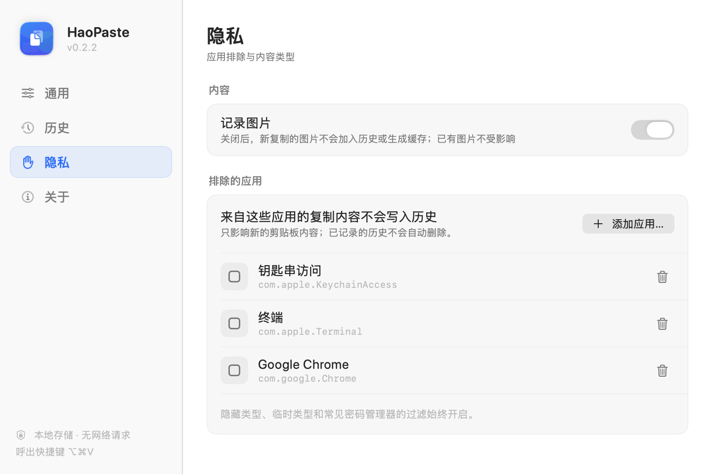

# HaoPaste

当前版本：**v0.2.2**

一款原生、轻快、键盘优先的 macOS 剪切板管理器。用 `⌥⌘V` 从任何应用呼出无标题栏悬浮面板，搜索、选择、复制，一气呵成。

> 设计目标：接近 Raycast / Paste 的精致感，同时保持 Apple Human Interface Guidelines 的原生语义与克制。

| 浅色 | 深色 |
| --- | --- |
|  |  |

*界面预览使用示例数据，由应用内置的离屏渲染工具生成。*

---

## 安装使用（无需 Xcode）

1. 构建或获取安装包：

   ```bash
   make dmg
   # 输出：
   # dist/HaoPaste-0.2.2.dmg
   # dist/HaoPaste-0.2.2.dmg.sha256
   ```

2. 双击打开 `dist/HaoPaste-0.2.2.dmg`，将 **HaoPaste** 拖入 **Applications / 应用程序**。
3. 从“应用程序”或 Spotlight 启动。首次启动会自动展示一次面板。
4. 之后随时按 `⌥⌘V`，或点击菜单栏的剪贴板图标呼出；右键菜单栏图标可暂停监听、清空记录或退出。

HaoPaste 是 `LSUIElement` 菜单栏应用，**不会出现在 Dock**；启动后请查看菜单栏图标。

也可以直接安装到本机并启动：

```bash
make install     # 安装到 /Applications（不可写时回退 ~/Applications）
```

DMG 使用本地 ad-hoc 签名。若首次打开时被 Gatekeeper 拦截，请在 Finder 中右键应用 → **打开**。

详细的安装、退出、卸载和 FAQ 见 [用户指南](Docs/USER_GUIDE.md)。

## 功能

- **系统级唤起**：默认 `⌥⌘V` 全局快捷键，或点击菜单栏剪贴板图标；快捷键可在设置中录入修改。
- **无标题栏悬浮面板**：`.regularMaterial` 磨砂背景、16pt 连续圆角、0.5pt 细描边、柔和阴影。
- **即时搜索**：按内容、来源应用、类型或格式搜索。
- **分类药丸**：全部 / 文本 / 代码 / 图片 / 链接，胶囊选中态平滑滑动。
- **键盘优先**：

  | 快捷键 | 行为 |
  | --- | --- |
  | `↑` `↓` | 切换选中条目 |
  | `↵` | 复制选中条目并关闭面板 |
  | `⌘1` – `⌘9` | 直接复制对应序号的条目 |
  | `⌘P` | 置顶 / 取消置顶 |
  | `⌘⌫` | 删除选中条目 |
  | `esc` | 有搜索词时清除搜索，否则关闭面板 |

- **卡片交互**：悬停高亮、1pt 微位移、弹簧动效；悬停后显示置顶与删除按钮；支持右键菜单。
- **点击外部关闭**：点击面板外侧、透明阴影留白区域或切换到其他应用时自动收起。
- **设置窗口**：自定义全局快捷键、登录时自动启动、暂停监听、历史容量、清空记录、打开数据目录。
- **隐私控制**：按应用排除剪贴板记录、关闭图片记录；隐藏类型过滤始终开启。
- **备份与迁移**：将历史与图片导出为 `.zip`，导入时自动合并、去重并保留置顶状态。
- **智能识别**：自动区分纯文本、链接、代码 / JSON、颜色值（HEX）与图片。
- **来源应用**：记录复制内容时最前方的应用名称。
- **图片缩略图**：原图与缩略图分文件缓存，列表只加载缩略图。
- **安全过滤**：忽略 `org.nspasteboard.ConcealedType`、临时类型、自动生成类型以及常见密码管理器的私有类型。
- **去重**：相同内容不会产生重复记录，而是刷新时间并回到顶部；置顶状态保留。
- **历史限制**：未置顶记录默认最多 200 条，FIFO 自动淘汰；可在设置中调整，置顶记录永不自动清理。
- **原生适配**：跟随系统浅色 / 深色外观与强调色，尊重“减弱动态效果”，全部图标使用 SF Symbols 分层渲染。

点击条目只执行「复制」，不会自动粘贴到上一个应用，因此应用不需要辅助功能（Accessibility）权限。

### 设置窗口

| 通用 | 隐私 |
| --- | --- |
|  |  |

打开方式：右键菜单栏图标 → **设置…**，或按 `⌘,`。

- **通用**：登录时自动启动、录制新的全局快捷键、暂停 / 恢复监听。
- **历史**：100 / 200 / 500 / 1000 条未置顶记录上限、清空未置顶或全部记录、在 Finder 中打开数据目录；导出 / 导入完整历史备份。
- **隐私**：关闭图片记录、排除指定应用（从“应用程序”选择），被排除应用的新复制内容不会入库。
- **关于**：版本、快捷键、隐私与权限信息。

## 开发运行

环境要求：macOS 14+、Xcode 15+（本工程使用 Xcode 26.5 构建验证）。

```bash
# 开发调试
make run       # Debug 构建并打开
make demo      # 用可复现的示例数据启动，便于查看界面

# 日常使用 / 发布
make release   # Release 构建
make dmg       # 生成 dist/HaoPaste-<version>.dmg
make install   # 安装到 /Applications 并启动
```

也可以直接打开 `HaoPaste.xcodeproj` 运行。工程由 [XcodeGen](https://github.com/yonaskolb/XcodeGen) 从 `project.yml` 生成；新增源文件后运行 `make project` 或 `xcodegen generate` 重新生成工程。

首次启动后，应用会驻留在菜单栏。按 `⌥⌘V` 呼出面板。详细构建、签名与公证流程见 [开发与发布文档](Docs/DEVELOPMENT.md)。

## 快捷键与交互细节

- 在搜索框中输入会即时过滤；`esc` 第一次清空搜索，第二次关闭面板。
- 面板失焦时自动关闭，并把焦点还给之前的应用。
- 鼠标悬停在条目上显示置顶 / 删除按钮；点击条目主体复制。
- 被选中条目使用系统强调色底色与边框，键盘与鼠标操作共享同一套选中状态。
- `⌘1`–`⌘9` 对应当前过滤结果中的前九条。

## 数据结构与持久化

使用轻量 JSON 存储，无第三方依赖：

```text
~/Library/Application Support/HaoPaste/
├── history.json          # [ClipboardItem]
└── Images/
    ├── <UUID>.png        # 原图
    └── <UUID>-thumb.png  # 列表缩略图
```

导出的备份是一个未加密的 zip：

```text
HaoPasteBackup/
├── manifest.json        # schema、版本、导出时间、数量
├── history.json         # 全部记录（含置顶与来源应用）
└── Images/              # 原图与缩略图
```

开发与测试可以通过环境变量或启动参数覆盖存储位置：

```bash
HAOPASTE_STORAGE_DIR=/tmp/haopaste-dev ./HaoPaste.app/Contents/MacOS/HaoPaste
# 或
open -n HaoPaste.app --args --storage /tmp/haopaste-dev
```

核心模型：

```swift
struct ClipboardItem {
    let id: UUID
    var type: ClipboardItemType         // .text / .image / .colorHex / .url / .code
    var content: String                 // 文本内容，或图片文件名
    var plainText: String               // 搜索与纯文本输出
    var isPinned: Bool
    var createdAt: Date
    var sourceApp: SourceApplication?   // bundle ID + 名称
    var contentHash: String             // SHA-256 去重指纹
    var imageFileName: String?
    var thumbnailFileName: String?
    var imageDimensions: ImageDimensions?
}
```

## 架构

```text
HaoPaste/
├── App/
│   ├── HaoPasteApplication.swift    # AppKit 入口，菜单栏驻留应用
│   ├── AppDelegate.swift            # 依赖装配、主菜单、调试入口
│   ├── PanelController.swift        # NSPanel、定位、键盘事件、焦点恢复
│   ├── GlobalHotKey.swift           # Carbon 全局快捷键（默认 ⌥⌘V）
│   ├── SettingsWindowController.swift # 设置窗口托管
│   └── StatusBarController.swift    # 菜单栏图标与右键菜单
├── Services/
│   ├── ClipboardMonitor.swift       # changeCount 轮询、隐藏类型过滤
│   ├── ClipboardManager.swift       # 去重、置顶、FIFO、复制、可观察状态
│   ├── ClipboardStore.swift         # JSON 持久化与图片资产
│   ├── HistoryArchiveService.swift  # zip 备份导出 / 合并导入
│   ├── AppSettings.swift            # 快捷键 / 历史上限 / 登录项偏好
│   ├── ContentClassifier.swift      # 文本 / URL / JSON / 代码 / HEX 识别
│   ├── ContentHasher.swift          # SHA-256 指纹
│   └── ImageProcessor.swift         # PNG 归一化与缩略图生成
├── Models/
│   ├── ClipboardItem.swift
│   └── HotKeyConfiguration.swift    # 快捷键键码与显示
├── State/PanelViewState.swift       # 搜索、筛选、选中项与焦点
├── Views/                           # ContentView、ItemRowView、Settings
├── Theme/Theme.swift                # 圆角、间距、弹簧动效、细描边
└── Support/                         # DEMO 数据与离屏截图工具（仅 Debug）
```

### 监听流程

1. 每 350ms 比较一次 `NSPasteboard.general.changeCount`。
2. 检测到变化后，先过滤隐藏 / 临时 / 密码管理器类型。
3. 依次尝试图片、纯文本；对文本做类型识别与 SHA-256 指纹。
4. 与历史指纹比较：命中则更新时间并移到顶部，否则创建新记录。
5. 图片写入磁盘并生成缩略图；记录写入 JSON（400ms 防抖）。
6. 按设置上限裁剪未置顶历史；置顶记录始终保留。

### 复制流程

应用自身写入剪贴板后立即同步 `changeCount`，避免把「再次复制历史条目」误采集为一条新记录。同时刷新该条目的使用时间，使下次打开面板时位于更靠前的位置。

## 调试工具

Debug 构建内置用于视觉验收的参数：

```bash
# 离屏渲染面板截图（需要先通过 Launch Services 启动）
open -n .build/Build/Products/Debug/HaoPaste.app --args --render /tmp/panel.png --storage /tmp/haopaste-preview

# 深色外观渲染
launchctl setenv HAOPASTE_RENDER_APPEARANCE dark
open -n .build/Build/Products/Debug/HaoPaste.app --args --render /tmp/panel-dark.png --storage /tmp/haopaste-preview-dark
launchctl unsetenv HAOPASTE_RENDER_APPEARANCE
```

`make demo` 等价于以 `--demo --show --storage /tmp/haopaste-demo` 启动一个 Debug 实例。

## 文档

| 文档 | 内容 |
| --- | --- |
| [用户指南](Docs/USER_GUIDE.md) | 安装、启动、快捷键、菜单栏功能、卸载与 FAQ |
| [架构与技术](Docs/ARCHITECTURE.md) | 技术栈、模块、数据流、设计规范、隐私与性能 |
| [开发与发布](Docs/DEVELOPMENT.md) | 构建、调试参数、DMG、签名公证、测试检查单 |
| [路线规划](Docs/ROADMAP.md) | 版本计划、优先级、技术债、版本验收标准 |

## 已知边界

- 目前仅支持文本、链接、代码 / JSON、HEX 颜色和图片；文件、富文本、多图列表尚未纳入。
- 点击条目只复制，不自动粘贴（不申请辅助功能权限）。
- 未实现 iCloud 同步。
- 导出的 `.zip` 备份包含完整剪贴板内容，且未加密；请妥善保管。
- 登录时启动依赖 `SMAppService`；如果系统要求批准，需要在“系统设置 → 通用 → 登录项”中允许。
- 自定义快捷键目前使用固定键位名称映射，非美式键盘布局下显示文本可能与实际字符不同。
- 应用为本地 ad-hoc 签名；对外分发前需配置 Developer ID 与公证流程。
- 应用图标由 `Scripts/generate-app-icon.swift` 生成，可重复构建。

后续版本计划见 [ROADMAP.md](Docs/ROADMAP.md)。
